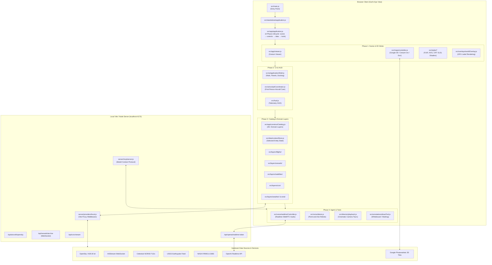

# God's Eye View (GEV) — Comprehensive System Design & Codebase Architecture

> **Purpose of this Document:**  
> This document serves as the master blueprint and file-by-file directory map of the **God's Eye View** repository. It is designed to give you a complete, crystal-clear understanding of what every folder and file is doing, how data flows through the application, and how to safely modify, strip down, or scale up features as you make this project your own.

---

## Table of Contents

1. [High-Level Executive Architecture](#1-high-level-executive-architecture)
2. [Core Design Principles & Boundary Rules](#2-core-design-principles--boundary-rules)
3. [End-to-End System Flow Diagram](#3-end-to-end-system-flow-diagram)
4. [Master Directory & File-by-File Breakdown](#4-master-directory--file-by-file-breakdown)
   - [Root Directory Files](#41-root-directory-files)
   - [`src/app/` — Application Orchestration & Lifecycle](#42-srcapp--application-orchestration--lifecycle)
   - [`src/standalone/` — Standalone Page Bootstrapping](#43-srcstandalone--standalone-page-bootstrapping)
   - [`src/layers/` — Domain Visualisation Layers](#44-srclayers--domain-visualisation-layers)
   - [`src/sources/` — Portable Data Acquisition & Ingestion](#45-srcsources--portable-data-acquisition--ingestion)
   - [`src/data/` — Feeds, State, Context & Offline Assets](#46-srcdata--feeds-state-context--offline-assets)
   - [`src/ui/` — User Interface, Cockpit HUD, Rails & Panels](#47-srcui--user-interface-cockpit-hud-rails--panels)
   - [`src/voice/` — Realtime AI Voice Agent & Spatial Deixis](#48-srcvoice--realtime-ai-voice-agent--spatial-deixis)
   - [`src/maps/` — 3D Basemaps, Google 3D Tiles & Terrain](#49-srcmaps--3d-basemaps-google-3d-tiles--terrain)
   - [`src/director/` & `src/scenes/` — Cinematic Tour & Replay System](#410-srcdirector--srcscenes--cinematic-tour--replay-system)
   - [`src/annotations/` — 3D & Screen Drawing Tools](#411-srcannotations--3d--screen-drawing-tools)
   - [`src/sdr/` — WebUSB Software-Defined Radio (RTL-SDR)](#412-srcsdr--webusb-software-defined-radio-rtl-sdr)
   - [`src/search/` — Multi-Engine Geocoder & Presets](#413-srcsearch--multi-engine-geocoder--presets)
   - [`src/services/` — Core Scene & Terrain Services](#414-srcservices--core-scene--terrain-services)
   - [`src/overlays/` — High-Performance GPU Text Overlay](#415-srcoverlays--high-performance-gpu-text-overlay)
   - [`src/styles/` — Sensor Post-Processing Shaders (FLIR, CRT, NVG)](#416-srcstyles--sensor-post-processing-shaders-flir-crt-nvg)
   - [`src/tools/` — Internal Tools & Analyst Engine](#417-srctools--internal-tools--analyst-engine)
   - [`src/view/` — Camera Viewport & Focus Arbitration](#418-srcview--camera-viewport--focus-arbitration)
   - [Root `src/*.js` — Core Utilities & Singletons](#419-root-srcjs--core-utilities--singletons)
   - [`server/` — Local Node Backend & Proxy Middleware](#420-server--local-node-backend--proxy-middleware)
   - [`build/` — Vite Configuration & HTML Ingestion](#421-build--vite-configuration--html-ingestion)
   - [`scripts/` — QA Suites, Doctor & Tooling](#422-scripts--qa-suites-doctor--tooling)
   - [`config/` — Municipal CCTV Feeds](#423-config--municipal-cctv-feeds)
   - [`public/` — 3D Models, Sound FX & Media](#424-public--3d-models-sound-fx--media)
   - [`tools/` — Offline CLI Data Processing Tools](#425-tools--offline-cli-data-processing-tools)
5. [How to Customize & Make It Your Own ("Developer Playbook")](#5-how-to-customize--make-it-your-own-developer-playbook)
   - [How to Add a New Layer](#51-how-to-add-a-new-layer)
   - [How to Remove or Disable Unneeded Layers](#52-how-to-remove-or-disable-unneeded-layers)
   - [How to Customize UI, Branding & Themes](#53-how-to-customize-ui-branding--themes)
   - [How to Add Custom Voice Commands or MCP Tools](#54-how-to-add-custom-voice-commands-or-mcp-tools)
6. [Open Questions & Architectural Decisions for You](#6-open-questions--architectural-decisions-for-you)

---

## 1. High-Level Executive Architecture

**God's Eye View (GEV)** is a planetary-scale situational intelligence console running entirely in the browser. It unifies dozens of disparate real-time feeds (commercial and military flights, maritime vessels, low-earth orbit satellites, live CCTV video streams, seismology, weather radar and wind, wildfire telemetry, and road traffic) onto a 3D digital twin of Earth powered by **CesiumJS** and **Google Photorealistic 3D Tiles**.

### Key Technical Pillars:

1. **Frontend Core:** Pure ES Modules (ESM) with zero heavy framework bloat (no React/Vue dependency — vanilla DOM nodes, custom lightweight Web Components, high-performance direct DOM updates).
2. **3D Geospatial Engine:** CesiumJS wrapped with custom terrain clamping, GLSL post-processing shaders (FLIR thermal vision, CRT phosphor, NVG night vision), and a custom canvas-based overlay renderer (`worldOverlay`) that avoids Cesium's slow entity label overhead.
3. **Local Node.js Dev & Proxy Server:** Integrated within Vite development server (`server/providers/local.js`). It proxies upstream APIs to bypass CORS, protect API credentials, provide in-memory/disk caching, and shield against rate-limiting.
4. **Voice & Multimodal Agent:** WebRTC connection to OpenAI Realtime API (or fallback Web Speech) supporting hands-free camera navigation, tool querying, and **spatial deixis** ("point and ask" / "What's that?").
5. **Model Context Protocol (MCP):** Stdio and HTTP MCP servers allowing external AI assistants (Claude Desktop, Cursor, ChatGPT) to control the globe, query geospatial databases, and generate dynamic share links.

---

## 2. Core Design Principles & Boundary Rules

To ensure this complex codebase remains maintainable, the original architecture adheres to strict rules enforced by automated test gates (`npm run check:boundaries`):

1. **4-Phase Linear Lifecycle (`src/app/application.js`):**
   Startup runs in strict sequence:
   $$\text{createScene} \longrightarrow \text{createControls} \longrightarrow \text{createData} \longrightarrow \text{createTools}$$
   Teardown runs in exact reverse order:
   $$\text{destroyTools} \longrightarrow \text{destroyControls} \longrightarrow \text{destroyData} \longrightarrow \text{destroyScene}$$
   Every resource acquired must register an explicit cleanup via `defer(() => cleanup())`.
2. **Pure Portable Sources (`src/sources/`):**
   Modules that fetch or parse upstream data (`src/sources/*`) **must never** import Cesium, the DOM (`window`, `document`), or Node-specific libraries. They must be pure JavaScript that can run anywhere.
3. **Layer Isolation:**
   Each domain layer in `src/layers/<family>/` encapsulates its own ingestion, Cesium entity creation, and cleanup. Layers never cross-import other layers directly; coordination occurs through the application catalog (`src/app/constructCatalog.js`) or shared application context (`src/data/contextStore.js`).
4. **Forbid Cesium Text Labels:**
   Native Cesium text billboards degrade performance at scale. All on-globe text labels must be rendered through the custom screen-space overlay host (`src/overlays/worldOverlay.js`).
5. **Keyless-First Default:**
   The entire application boots and functions without requiring any paid API keys (using Esri imagery, OpenStreetMap, OpenSky Network, USGS, and Celestrak). Keys for Cesium Ion, Google Maps 3D, and OpenAI Realtime are optional "power-ups".

---

## 3. End-to-End System Flow Diagram

---

## 4. Master Directory & File-by-File Breakdown

### 4.1 Root Directory Files

| File              | Purpose & Role                                                                                                                                               |
| :---------------- | :----------------------------------------------------------------------------------------------------------------------------------------------------------- |
| `package.json`    | Project manifest defining npm dependencies (Cesium, satellite.js, hls.js, mapillary-js, etc.) and comprehensive subpath exports mapping (`gods-eye-view/*`). |
| `vite.config.js`  | Dev server config. Re-exports `server/standalone/vite.config.js`, attaching all backend proxy middleware.                                                    |
| `index.html`      | Root HTML container. Mounts `#cesiumContainer`, loading screen overlays, HUD markup, and imports `src/main.js`.                                              |
| `style.css`       | Global master stylesheet defining tactical HUD aesthetics, scanlines, fonts, panel rails, and animations.                                                    |
| `.env.example`    | Template for optional API keys (`GOOGLE_MAPS_API_KEY`, `CESIUM_ION_TOKEN`, `OPENAI_API_KEY`, `MAPILLARY_CLIENT_TOKEN`, `TOMTOM_API_KEY`).                    |
| `DESIGN.md`       | _(This document)_ The architectural and file mapping guide.                                                                                                  |
| `DATA_SOURCES.md` | Comprehensive directory of all 30+ public data providers, licenses, endpoints, and attribution obligations.                                                  |
| `TESTING.md`      | Test strategy documentation covering the dual testing approach (headless node unit tests and full Puppeteer browser QA).                                     |
| `SECURITY.md`     | Security policy covering input sanitization, API key storage hardening, and same-origin proxy guards.                                                        |
| `CONTRIBUTING.md` | Contributor guidelines and branch commit standards.                                                                                                          |

---

### 4.2 `src/app/` — Application Orchestration & Lifecycle

This folder orchestrates application startup, viewer initialization, and dependency injection across the four phases.

| File                      | Purpose                                                                                                                                                                                         |
| :------------------------ | :---------------------------------------------------------------------------------------------------------------------------------------------------------------------------------------------- |
| `application.js`          | The lifecycle engine. Implements `createApplication()`. Executes `createScene`, `createControls`, `createData`, and `createTools` with `AbortSignal` propagation and rollback/cleanup handling. |
| `viewer.js`               | Factory creating the Cesium `Viewer` instance with optimized performance defaults (FXAA, shadows disabled, terrain settings, credit container handling).                                        |
| `constructCatalog.js`     | Assembles the complete array of 26+ domain layers with their respective feeds, surface samplers, and classification registries.                                                                 |
| `catalog.js`              | Low-level layer registry managing layer registration, ordering, query-by-id, and lifecycle transitions (`enable`/`disable`).                                                                    |
| `sourceComposition.js`    | Declarative mapping defining which sources feed which layers, handling fallback policies and availability lookups.                                                                              |
| `scene.js`                | Coordinates scene-level setup: viewer creation, terrain attribution, and base map initialization.                                                                                               |
| `controls.js`             | Instantiates HUD, camera orientation controls, style management, and navigation handlers.                                                                                                       |
| `data.js`                 | Connects the layer catalog to the viewer and restores persisted/shared layer states.                                                                                                            |
| `tools.js`                | Mounts interactive tools: scene director, drawing annotations, voice controller, and keyboard shortcuts.                                                                                        |
| `surfaceServices.js`      | Provides terrain altitude sampling and ground clamping to keep aircraft, vehicles, and models glued to 3D elevation.                                                                            |
| `localGeojsonServices.js` | Service adapter wiring local infrastructure GeoJSON layers (datacenters, dams) into the catalog.                                                                                                |
| `sourceSlot.js`           | Lightweight reactive holder for dynamic data sources supporting runtime hot-swapping.                                                                                                           |
| `startupChrome.js`        | Manages the initial boot loading screen, progress indicator, and error messaging.                                                                                                               |
| `errors.js`               | Normalizes and pretty-prints startup errors.                                                                                                                                                    |

---

### 4.3 `src/standalone/` — Standalone Page Bootstrapping

Adapts the reusable `gods-eye-view` package into the standalone single-page web application.

| File               | Purpose                                                                                                                         |
| :----------------- | :------------------------------------------------------------------------------------------------------------------------------ |
| `application.js`   | `createStandaloneApplication()` — reads environment variables, attaches DOM loading elements, and instantiates the application. |
| `catalog.js`       | Factory creating the standalone layer catalog using default local sources.                                                      |
| `layerSources.js`  | Maps environment variables and local proxy endpoints to standard layer source options.                                          |
| `controls.js`      | Wires standalone UI components to the application shell.                                                                        |
| `data.js`          | Standalone layer registration and QA diagnostic hooks.                                                                          |
| `tools.js`         | Standalone mounting for voice, director, and drawing tools.                                                                     |
| `placeSearch.js`   | Configures the default place search using bundled landmark presets and Google/Nominatim fallbacks.                              |
| `startupChrome.js` | Standalone loading screen DOM controller.                                                                                       |
| `toolCatalog.js`   | Exposes internal application queries to the local MCP server and voice assistant.                                               |

---

### 4.4 `src/layers/` — Domain Visualisation Layers

The core of God's Eye View. Each folder encapsulates a distinct geospatial domain. Most layers follow a clean internal structure:

- `source.js`: Portable data fetcher / API adapter.
- `ingestion.js`: Parses and normalizes incoming data points into records.
- `model.js` / `records.js`: In-memory data store for live tracks and history.
- `rendering.js`: Creates and updates Cesium entities (billboards, 3D glTF models, polylines).
- `controls.js` / `cards.js`: UI inspection cards and sidebar toggles.

| Layer Subdirectory | Domain & Functionality                                                                                                   |
| :----------------- | :----------------------------------------------------------------------------------------------------------------------- |
| `aircraft/`        | Shared aircraft 3D model selection (`787`, `ATR72`, `C172`, `MQ9`), classification, and sizing algorithms.               |
| `flights/`         | Commercial flight tracking via OpenSky Network and ADSB.lol fallback. Computes velocity, altitude, and contrails.        |
| `military/`        | Military aircraft filter & tactical telemetry. Correlates ICAO hex codes against known military serials and bases.       |
| `localAdsb/`       | Hardware-in-the-loop layer. Ingests raw ADS-B Mode-S packets from a local SDR dongle or dump1090 stream.                 |
| `vessels/`         | Live global maritime vessel tracking (cargo, tankers, passenger ships) via AISStream WebSocket proxy.                    |
| `satellites/`      | Real-time satellite orbit propagation. Propagates NORAD Two-Line Element (TLE) sets using `satellite.js` (SGP4).         |
| `launches/`        | Past and upcoming orbital rocket launches from Launch Library 2 with estimated ballistic trajectories.                   |
| `cctv/`            | Public municipal and highway traffic cameras. Displays interactive 3D frustum viewsheds and HLS/MJPEG live video.        |
| `weather/`         | Global weather overlays. Animates radar precipitation, satellite cloud cover, and lightning strikes across time.         |
| `wind/`            | Global forecast wind streamlines. Decodes GFS/ECMWF GRIB2 grids into GPU-rendered animated particle vectors.             |
| `cyclones/`        | National Hurricane Center (NHC) active tropical cyclone forecasts, storm paths, wind radiuses, and cones of uncertainty. |
| `earthquakes/`     | USGS global seismic activity (M1.0+ / M4.5+). Visualizes epicentre depth, magnitude rings, and shake intensity.          |
| `firms/`           | NASA FIRMS (MODIS / VIIRS) satellite thermal hotspots indicating active wildfires and biomass burning.                   |
| `perimeters/`      | National Interagency Fire Center (NIFC) active wildfire polygon boundaries and containment lines.                        |
| `alpr/`            | OpenStreetMap Automated License Plate Recognition (ALPR) camera locations and surveillance coverage.                     |
| `streetLevel/`     | Mapillary and 360-degree street-level photo viewer integration with interactive heading and panorama viewer.             |
| `traffic/`         | TomTom Traffic Flow vector tiles. Visualizes real-time highway congestion and jam speeds.                                |
| `transit/`         | Live public transit (buses, trains, ferries) using GTFS-RT feeds with vehicle movement interpolation.                    |
| `bikeshare/`       | Global Bikeshare Feed Specification (GBFS) stations showing real-time dock and bike availability.                        |
| `submarineCables/` | TeleGeography global undersea fiber-optic communication cables and cable landing stations.                               |
| `installations/`   | Global military bases, airfields, radar sites, and naval stations extracted from OpenStreetMap.                          |
| `awareness/`       | Joint intelligence situational overlay correlating nearby flights, vessels, and bases within a tactical radius.          |
| `recentImagery/`   | NASA GIBS / Sentinel / Landsat recent high-resolution multispectral satellite imagery tiles.                             |
| `directions/`      | Routing and waypoint navigation path generation (walking, driving, flythroughs).                                         |

---

### 4.5 `src/sources/` — Portable Data Acquisition & Ingestion

Pure JavaScript adapters responsible for fetching and parsing raw data. **Zero DOM or Cesium dependencies.**

| File                                      | Purpose                                                                          |
| :---------------------------------------- | :------------------------------------------------------------------------------- |
| `live/aircraft.js`                        | Client-side poller for OpenSky and ADSB.lol aircraft state vectors.              |
| `live/vessels.js`                         | Client-side listener for AISStream maritime messages.                            |
| `celestrak.js` / `tle.js`                 | Fetches and parses NORAD Two-Line Element orbital sets from CelesTrak.           |
| `overpass.js` / `overpassFeatures.js`     | Queries OpenStreetMap Overpass API for infrastructure, military tags, and roads. |
| `radioBrowser.js`                         | Queries the Community Radio Browser API for streaming radio stations worldwide.  |
| `gbfsStations.js`                         | Parses GBFS feeds for city bike-share systems.                                   |
| `transitService.js` / `transitHistory.js` | Ingests and buffers real-time transit GTFS feeds.                                |
| `openFreeMap.js`                          | Vector tile parser for OpenFreeMap base data.                                    |
| `vectorTiles.js`                          | Mapbox Vector Tile (MVT/PBF) decoders.                                           |
| `windBody.js`                             | Decodes compressed binary wind grids for meteorological rendering.               |
| `rateLimit.js` / `requestDeadline.js`     | Client-side request budgeting and timeout management.                            |

---

### 4.6 `src/data/` — Feeds, State, Context & Offline Assets

Maintains global application state, entity selection, offline GeoJSON datasets, and geospatial analysis.

| File / Subfolder                    | Purpose                                                                                                                                         |
| :---------------------------------- | :---------------------------------------------------------------------------------------------------------------------------------------------- |
| `contextStore.js`                   | Central state store for currently selected/hovered entities (flights, ships, cameras).                                                          |
| `analystEngine.js`                  | Spatial query engine capable of counting, filtering, and ranking entities ("find flights within 50km of X").                                    |
| `trackedCamera.js`                  | Camera tracking coordinator that locks camera focus onto a moving target (aircraft/ship/satellite).                                             |
| `detection.js`                      | Screen-space bounding box detection overlay generator (draws green tactical targeting brackets).                                                |
| `tr3bRegistry.js`                   | Easter egg / special tactical stealth aircraft registry.                                                                                        |
| `regionalBrief.js`                  | Aggregates weather, local news, and geopolitical facts for any clicked point on Earth.                                                          |
| `adminBoundaries.js`                | Loads country, state, and county political boundaries.                                                                                          |
| `satellitePass.js`                  | Computes visible satellite pass predictions (rise, peak azimuth, set times) for any observer point.                                             |
| `cctvGizmo.js` / `cctvFootprint.js` | Calculates camera field-of-view (FOV) projection cones onto 3D terrain.                                                                         |
| `local_data/`                       | Bundled static datasets: `dams/`, `datacenters/`, `natural_earth/`, `neighborhoods/`, `osm_military_names/`, `telegeography_submarine_cables/`. |
| `fixtures/`                         | Sample captured packets and test data for automated regression verification.                                                                    |

---

### 4.7 `src/ui/` — User Interface, Cockpit HUD, Rails & Panels

Manages all user interface components, side rails, docking windows, and HUD controls.

| File                                        | Purpose                                                                                                                |
| :------------------------------------------ | :--------------------------------------------------------------------------------------------------------------------- |
| `applicationShell.js`                       | Master UI coordinator. Manages panel layout, keybindings, and rail geometry.                                           |
| `shellFacade.js`                            | High-level facade exposing UI methods to layers, voice commands, and scene playback.                                   |
| `cockpitCoordinator.js` / `cockpit.js`      | Controls the immersive Cockpit Mode (rides inside an aircraft with real instruments, attitude indicator, and horizon). |
| `cockpitCamera.js`                          | Camera math keeping the viewpoint locked inside the aircraft cockpit with terrain clearance safeguards.                |
| `panelRails.js` / `panelChrome.js`          | Left and right sidebar docking rails, glassmorphic card containers, and collapse/expand disclosure.                    |
| `panelResize.js` / `panelMeasurement.js`    | Drag-to-resize and auto-docking physics for UI panels.                                                                 |
| `navigationController.js`                   | High-level camera navigation (fly to coordinates, orbit, reset to global view, north-up tilt).                         |
| `locationControls.js` / `locationSearch.js` | Search bar UI for looking up cities, airports, coordinates, and landmarks.                                             |
| `layerPanel.js` / `layerBindings.js`        | The Layer Drawer where users toggle individual feeds on and off.                                                       |
| `visualSettings.js` / `visualEffects.js`    | Controls for post-processing shaders (FLIR, Night Vision, Bloom, Vignette, Scanlines).                                 |
| `radioControls.js` / `radioPresentation.js` | Global radio player tuning in to local AM/FM/Internet radio near the camera location.                                  |
| `cctvControls.js` / `cctvPresentation.js`   | CCTV stream viewing panel with live HLS video playback.                                                                |
| `weatherPanel.js`                           | Timeline playback controls for scrubbing weather radar, clouds, and forecast winds.                                    |
| `streetLevelControls.js`                    | Controls and viewport for embedded 360-degree street photography.                                                      |
| `shareRestoration.js`                       | Encodes and decodes URL share hashes containing camera position, active layers, and tracked targets.                   |

---

### 4.8 `src/voice/` — Realtime AI Voice Agent & Spatial Deixis

Enables hands-free voice control and multimodal geospatial intelligence via OpenAI Realtime API.

| File                                   | Purpose                                                                                                                                                         |
| :------------------------------------- | :-------------------------------------------------------------------------------------------------------------------------------------------------------------- |
| `realtimeController.js`                | Coordinates voice session state, WebRTC audio streams, microphone permissions, and status indicator.                                                            |
| `gevActions.js`                        | The action execution engine. Maps incoming tool calls from the AI into concrete application operations (flying the camera, toggling layers, selecting targets). |
| `actionSchemas.js`                     | Declarative JSON schemas sent to the LLM describing all available voice tools.                                                                                  |
| `deixis.js`                            | **Spatial Deixis Engine:** Resolves "What is _that_?" queries by correlating user mouse reticle pointing with 3D entities.                                      |
| `pointerPick.js` / `pointerReticle.js` | Raycasts mouse pointer against 3D globe entities to provide context to the voice assistant.                                                                     |
| `realtimeTurns.js`                     | Manages voice turn-taking, interruption handling, and speech synthesis buffering.                                                                               |
| `realtimeRadio.js`                     | Automatically ducks or pauses background radio playback while the voice assistant is speaking.                                                                  |
| `voiceCard.js` / `resultDisplay.js`    | HUD transcript cards displaying spoken responses and numbered referent lists.                                                                                   |
| `earcon.js`                            | Tactical acoustic feedback (beeps, radio chirps, confirm chimes) for voice interactions.                                                                        |
| `speech.js`                            | Browser Web Speech API fallback when OpenAI Realtime credentials are not provided.                                                                              |

---

### 4.9 `src/maps/` — 3D Basemaps, Google 3D Tiles & Terrain

Manages map imagery layers, photorealistic 3D tile sets, and elevation services.

| File            | Purpose                                                                                                  |
| :-------------- | :------------------------------------------------------------------------------------------------------- |
| `controller.js` | Map stack controller managing active basemaps, opacity, and imagery tile providers.                      |
| `catalog.js`    | Catalog of available map sources (Esri Satellite, OpenStreetMap, CartoDB Dark/Positron, Google 3D).      |
| `google3d.js`   | Loader for Google Photorealistic 3D Tiles with automated bounding box queries and quota handling.        |
| `terrain.js`    | Manages world digital elevation models (Cesium World Terrain, keyless terrain approximations).           |
| `credits.js`    | Attribution manager ensuring provider copyright and license notices are rendered per legal requirements. |

---

### 4.10 `src/director/` & `src/scenes/` — Cinematic Tour & Replay System

A full cinematic camera choreography and historical scenario replay engine.

| File                                | Purpose                                                                                                                          |
| :---------------------------------- | :------------------------------------------------------------------------------------------------------------------------------- |
| `director/playback.js`              | Sequential shot queue execution with easing, camera travel, camera hold, and settling phases.                                    |
| `director/timeline.js` / `clock.js` | Playback clocks, keyframe interpolation, and seek calculation.                                                                   |
| `director/cameraDocument.js`        | Serializes and parses versioned `.gevscene` scene documents.                                                                     |
| `scenes/director.js`                | High-level Scene Director UI and authoring suite.                                                                                |
| `scenes/nepalEvidencePack.js`       | Bundled investigative replay of the 2026 Bhote Koshi glacial flood disaster with drone clips and before/after satellite imagery. |

---

### 4.11 `src/annotations/` — 3D & Screen Drawing Tools

Interactive whiteboard system for drawing boundaries, tactical markers, and lines directly on the globe.

| File                          | Purpose                                                                                                |
| :---------------------------- | :----------------------------------------------------------------------------------------------------- |
| `drawTool.js` / `drawMode.js` | Mouse interaction handler for drawing points, lines, polygons, and circles on the globe surface.       |
| `worldAnnotationRenderer.js`  | Renders drawn geometries as 3D polylines and clamped surface polygons in Cesium.                       |
| `screenAnnotationRenderer.js` | Renders 2D screen-space tactical overlays.                                                             |
| `annotationResolver.js`       | Natural language geographic polygon resolver ("outline Texas" -> fetches admin boundary and draws it). |

---

### 4.12 `src/sdr/` — WebUSB Software-Defined Radio (RTL-SDR)

Allows connecting a physical \$30 RTL-SDR USB dongle directly to the browser via WebUSB to receive real RF signals.

| File                                   | Purpose                                                                              |
| :------------------------------------- | :----------------------------------------------------------------------------------- |
| `controller.js`                        | WebUSB device acquisition, driver initialization, and tuning state.                  |
| `usbDevices.js`                        | RTL-SDR chipset USB vendor/product ID negotiation.                                   |
| `adsbDecoder.js`                       | Decodes 1090 MHz Mode-S / ADS-B pulses into live aircraft positions on a web worker. |
| `spectrum.js`                          | FFT fast Fourier transform waterfall and spectrum visualizer.                        |
| `sdr.worker.js` / `sdrAudioWorklet.js` | High-performance audio DSP and demodulation worklets.                                |

---

### 4.13 `src/search/` — Multi-Engine Geocoder & Presets

Multi-tiered geocoding engine providing instantaneous navigation without API keys.

| File                  | Purpose                                                                                        |
| :-------------------- | :--------------------------------------------------------------------------------------------- |
| `coordinateParser.js` | Parses latitude/longitude in all common formats (Decimal Degrees, DMS, MGRS grid coordinates). |
| `presetGeocoder.js`   | Instant offline search against hundreds of bundled landmark POIs and world capitals.           |
| `nominatim.js`        | OpenStreetMap Nominatim geocoder fallback.                                                     |
| `google.js`           | Google Places API geocoder (used when Google Maps API key is configured).                      |
| `placeSearch.js`      | Orchestrator trying offline presets first, then Google, then Photon/Nominatim.                 |

---

### 4.14 `src/services/` — Core Scene & Terrain Services

| File                               | Purpose                                                                                                     |
| :--------------------------------- | :---------------------------------------------------------------------------------------------------------- |
| `groundFloor.js` / `groundSnap.js` | Accurately clamps entities to 3D terrain elevation to prevent models from floating or clipping underground. |
| `terrainHeights.js`                | Asynchronous terrain height cache and batch sampling queries.                                               |
| `requests.js`                      | Centralized fetch wrapper with abort signals, deduplication, and error recovery.                            |

---

### 4.15 `src/overlays/` — High-Performance GPU Text Overlay

| File                  | Purpose                                                                                                  |
| :-------------------- | :------------------------------------------------------------------------------------------------------- |
| `worldOverlay.js`     | High-speed 2D HTML5 canvas overlay tracking 3D coordinates. Replaces Cesium's slow DOM/billboard labels. |
| `worldOverlayDraw.js` | Canvas drawing pipeline for tactical target labels, flight numbers, altitudes, and callsigns.            |

---

### 4.16 `src/styles/` — Sensor Post-Processing Shaders (FLIR, CRT, NVG)

GLSL post-processing fragment shaders that modify the final rendered frame.

| File              | Shader Effect                                                                                   |
| :---------------- | :---------------------------------------------------------------------------------------------- |
| `thermal.js`      | **FLIR (Forward Looking Infrared):** Thermal white-hot/black-hot gradient with edge sharpening. |
| `surveillance.js` | **NVG (Night Vision):** Green phosphor intensification with film grain and optical distortion.  |
| `retro.js`        | **CRT Monitor:** Cathode-ray scanlines, RGB phosphor triad mask, and chromatic aberration.      |
| `noir.js`         | **Noir:** High-contrast desaturated monochrome intelligence imagery.                            |
| `anime.js`        | **Cel-Shading:** Stylized comic/anime edge detection.                                           |
| `snow.js`         | **Winter / Snow:** Dynamic terrain color replacement for alpine conditions.                     |

---

### 4.17 `src/tools/` — Internal Tools & Analyst Engine

| File                      | Purpose                                                                                                                          |
| :------------------------ | :------------------------------------------------------------------------------------------------------------------------------- |
| `index.js` / `catalog.js` | Exposes geospatial queries to AI agents and analyst scripts.                                                                     |
| `queries/*`               | Specialized query modules: `aviation.js`, `maritime.js`, `space.js`, `cables.js`, `hazards.js`, `surveillance.js`, `weather.js`. |
| `mcp/*`                   | Model Context Protocol protocol adapters converting tool calls to JSON-RPC over stdio or HTTP.                                   |

---

### 4.18 `src/view/` — Camera Viewport & Focus Arbitration

| File       | Purpose                                                                                                              |
| :--------- | :------------------------------------------------------------------------------------------------------------------- |
| `index.js` | Manages camera frustum calculations, view targets, and handoffs between autonomous tracking and manual user panning. |

---

### 4.19 Root `src/*.js` — Core Utilities & Singletons

| File                | Purpose                                                                                                                  |
| :------------------ | :----------------------------------------------------------------------------------------------------------------------- |
| `main.js`           | Frontend entry point loaded by `index.html`. Reads environment flags and boots the standalone application.               |
| `cameraVerbs.js`    | Smooth camera movement routines: flyTo, orbitAround, lookAt, and interruptible transitions.                              |
| `hud.js`            | `IntelHUD` — the top/bottom tactical telemetry overlay displaying heading, altitude, coordinates, and system time.       |
| `keySetup.js`       | The "Power Up" UI modal where users can enter API keys directly in the browser and save them to local storage or server. |
| `splitFlap.js`      | Retro airport-style split-flap mechanical text flip animation for HUD coordinates and callsigns.                         |
| `scopeMask.js`      | Surveillance scope circular vignette overlay with customizable crosshairs.                                               |
| `celestialRing.js`  | 3D orbital altitude reference rings drawn in space around the globe.                                                     |
| `locations.js`      | Pre-defined coordinates and camera angles for major global cities and strategic hotspots.                                |
| `bloom.js`          | WebGL bloom/glow post-processing effect.                                                                                 |
| `renderGovernor.js` | Dynamic framerate throttler. Reduces rendering loops when the scene is static to save laptop battery and GPU power.      |

---

### 4.20 `server/` — Local Node Backend & Proxy Middleware

Runs inside the local Vite server process to bridge browser requests to the real world.

| Directory / File                 | Purpose                                                                                                                                                |
| :------------------------------- | :----------------------------------------------------------------------------------------------------------------------------------------------------- |
| `server/providers/local.js`      | The master middleware router mounting all backend proxy routes.                                                                                        |
| `server/providers/aircraft/`     | Proxies OpenSky Network (`opensky.js`), ADSB.lol (`adsb-lol.js`), and ADSB-DB aircraft metadata enrichment (`enrichment.js`).                          |
| `server/providers/vessels/`      | Manages persistent WebSocket connection to AISStream.io and broadcasts live ship data to browser clients (`ais-live.js`).                              |
| `server/providers/cctv/`         | Fetches, proxies, and transcodes live CCTV video feeds and snapshots (`cctv.js`, `stream.js`, `media.js`).                                             |
| `server/providers/openai/`       | Requests ephemeral WebRTC authentication tokens from OpenAI Realtime API so client browsers never expose secret API keys (`openai.js`, `realtime.js`). |
| `server/providers/weather.js`    | Proxies live RainViewer precipitation radar tiles and infrared cloud mosaics.                                                                          |
| `server/providers/wind/`         | Downloads and decodes NOAA GFS and ECMWF weather model wind data (`gfs.js`, `ifs.js`).                                                                 |
| `server/providers/space.js`      | Proxies Celestrak satellite orbital elements and Launch Library 2 mission data.                                                                        |
| `server/providers/overpass/`     | Proxies OpenStreetMap Overpass queries with on-disk caching to prevent rate-limit bans.                                                                |
| `server/providers/places.js`     | Proxies Google Places text search and details requests.                                                                                                |
| `server/providers/mapillary.js`  | Proxies Mapillary vector tiles and 360-degree street photography.                                                                                      |
| `server/standalone/key-setup.js` | Local filesystem handler securely writing user-entered API keys to `.env` or local cache.                                                              |
| `server/mcp/`                    | Model Context Protocol server (`stdio.js` for CLI agents and `plugin.js` for HTTP).                                                                    |

---

### 4.21 `build/` — Vite Configuration & HTML Ingestion

| File               | Purpose                                                                                                        |
| :----------------- | :------------------------------------------------------------------------------------------------------------- |
| `vite.js`          | Custom Vite plugin configuration for bundling CesiumJS assets, workers, and third-party WebAssembly libraries. |
| `allowedHosts.js`  | Network security helper validating host headers to prevent DNS rebinding attacks.                              |
| `embed-framing.js` | Security header injection controlling whether God's Eye View can be embedded in external iframes.              |
| `panel.js`         | Custom build script packaging the lightweight MCP web panel (`build:panel`).                                   |

---

### 4.22 `scripts/` — QA Suites, Doctor & Tooling

God's Eye View includes an extensive automated verification pipeline.

| Script / Suite                 | Purpose                                                                                                                           |
| :----------------------------- | :-------------------------------------------------------------------------------------------------------------------------------- |
| `setup-doctor.mjs`             | `npm run doctor` — checks Node version compatibility (Node 24 or 26 required) and validates environment setup.                    |
| `check-import-directions.mjs`  | Architecture gate verifying that no browser module imports Node code, and no portable source imports Cesium.                      |
| `check-package-boundaries.mjs` | Verifies export boundaries defined in `package.json`.                                                                             |
| `run-unit-tests.mjs`           | `npm test` — runs fast, zero-dependency unit tests across mathematical, parsing, and policy modules.                              |
| `qa-*.mjs`                     | 40+ Puppeteer-based end-to-end browser QA tests verifying visual rendering, camera transitions, layer activations, and UI panels. |

---

### 4.23 `config/` — Municipal CCTV Feeds

Pre-configured CCTV surveillance camera source catalogs containing stream endpoints, coordinates, and view directions:

- `cctv_sources.austin.json`: City of Austin & TxDOT highway cameras.
- `cctv_sources.shinjuku.json`: Tokyo Shinjuku street cameras.
- `cctv_sources.tallinn.json`: Tallinn, Estonia urban cameras.
- `cctv_sources.warendorf.json`: Warendorf, Germany traffic cameras.

---

### 4.24 `public/` — 3D Models, Sound FX & Media

Static assets served directly at the web root:

- `models/`: High-detail 3D glTF/GLB models used on the globe:
  - `b789.glb`: Boeing 787-9 Dreamliner (Commercial airliner).
  - `atr72.glb`: ATR 72 regional twin-turboprop.
  - `c172.glb`: Cessna 172 Skyhawk (General aviation).
  - `bell206.glb`: Bell 206 JetRanger helicopter.
  - `citation2.glb`: Cessna Citation II private business jet.
  - `mq9.glb`: General Atomics MQ-9 Reaper combat drone.
  - `airplane.glb` / `jet.glb`: Generic fixed-wing aircraft.
  - `ship.glb`: Generic container / cargo vessel.
- `events/bhote-koshi-2026/`: Pre- and post-flood high-res satellite imagery and event metadata for the Nepal flood replay.
- `mic.svg`, `location.svg`, `pin.svg`, `visual-presets.svg`: Vector interface icons.

---

### 4.25 `tools/` — Offline CLI Data Processing Tools

Standalone Node.js utilities for data preprocessing:

- `cesium-render.mjs`: Headless Puppeteer Cesium renderer for generating automated high-res screenshots.
- `sat-ortho.mjs`: Orthorectifies raw satellite imagery tiles.
- `streetview-panorama.mjs` / `pano-pinhole.mjs`: Stitches and extracts rectilinear camera views from 360-degree street panoramas.

---

## 5. How to Customize & Make It Your Own ("Developer Playbook")

### 5.1 How to Add a New Layer

To add your own custom real-time or static data feed (e.g., drone fleet, weather buoys, delivery trucks, mining sensors):

1. **Create the Portable Source Adapter (`src/sources/myFeed.js`):**
   Write a pure JS class/function that fetches from your API or WebSocket and normalizes items to `{ id, lat, lon, alt, name, heading, speed }`.
2. **Create the Layer Directory (`src/layers/myFeed/`):**
   - `model.js`: Stores active items.
   - `rendering.js`: Implements `init(viewer)`, `enable(viewer)`, `disable(viewer)`, `update(viewer)` using Cesium `Entity` or `BillboardCollection`.
   - `index.js`: Exports `createMyFeedLayer({ source, surface })`.
3. **Register in Catalog (`src/app/constructCatalog.js`):**
   Import your layer and add it to `createLayerCatalog([...])`.
4. **Assign a State Token (`src/data/layerState.js`):**
   Run `npm run layer-token:next` to get an unassigned 2-character token (used for URL share links).
5. **Add Server Proxy if Needed (`server/providers/myFeed.js`):**
   If the upstream feed requires API keys or suffers from CORS issues, add a proxy middleware in `server/providers/local.js`.

### 5.2 How to Remove or Disable Unneeded Layers

Because GEV is modular, you can trim down features you do not need:

- **To remove a feed from the UI:** In `src/app/constructCatalog.js`, simply comment out or delete the corresponding `createApplication*` invocation from the catalog array.
- **To remove its backend proxy:** In `server/providers/local.js`, remove its proxy middleware from `localProviderPlugins()`.
- **To check integrity:** Run `npm run check:boundaries` and `npm test` to ensure no lingering import dependencies remain.

### 5.3 How to Customize UI, Branding & Themes

- **Application Title & Logos:** Modify `index.html` (page title, loading banner) and replace `public/logo.svg`.
- **Theme Colors & Typography:** Edit `style.css`. Key CSS variables control the primary phosphor accent (default amber `#e0a030` and tactical cyan `#40c0ff`).
- **Telemetry HUD:** Modify `src/hud.js` to change what stats appear on the top/bottom bars (e.g., change coordinates, speed units, or tactical alerts).
- **Default Startup Location:** Edit `src/locations.js` (`GLOBE_VIEW` or default POI) to have the camera initialize over your preferred country, base, or city.

### 5.4 How to Add Custom Voice Commands or MCP Tools

- **Add Voice Actions (`src/voice/gevActions.js`):**
  Add your command handler inside `executeVoiceAction(name, args, context)`.
- **Declare Schema (`src/voice/actionSchemas.js`):**
  Add the JSON Schema definition explaining the parameters to the LLM.
- **Expose to MCP Agents (`src/tools/queries/`):**
  Implement the query function in `src/tools/queries/` and register it in `src/tools/catalog.js` so Claude, Cursor, or external LLMs can call it.

---

## 6. Open Questions & Architectural Decisions for You

As we prepare to modify this project and tailor it to your vision, please consider:

1. **Target Domain / Purpose:** What is the primary focus of your customized version?
   - _Tactical / Defense OSINT:_ Focus on military aircraft, naval tracking, radar sites, satellite passes, and FLIR vision.
   - _Commercial Aviation & Maritime:_ Focus on passenger flights, flight tracking, cockpit HUD, cargo ships, and port cameras.
   - _Climate & Natural Hazards:_ Focus on wildfires, earthquakes, cyclone tracks, weather radar, and flood replays.
   - _Smart City & Urban Intelligence:_ Focus on municipal CCTV, transit, bike-share, ALPR, and street-level imagery.
   - _Custom Fleet / Private Telemetry:_ Connecting your own private API or vehicle fleet.
2. **Feature Pruning:** Are there specific layers or heavy components (such as WebUSB SDR, Mapillary street view, or 3D cockpits) that you want stripped out immediately to keep the codebase lean?
3. **Voice & AI Assistant:** Do you intend to use the OpenAI Realtime voice agent, or would you prefer integrating local LLMs (e.g., Ollama / WebLLM), Anthropic Claude, or removing voice in favor of a pure graphical dashboard?
4. **Branding & Visuals:** Do you want a complete UI reskin (new project name, custom dark/light theme, custom HUD styling)?

---

_(You can refer back to this document at any point during development as our architectural source of truth.)_
